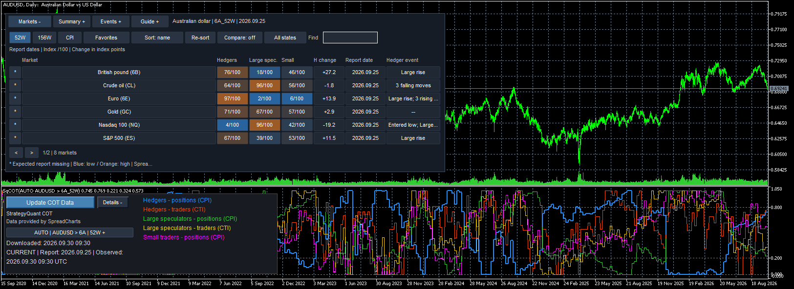

# Quant Data Manager

[](LICENSE)
[](https://github.com/strategyquantsro/quant-data-manager/releases)
[](https://github.com/strategyquantsro/quant-data-manager/actions/workflows/checksums.yml)
[](https://strategyquantsro.github.io/quant-data-manager/)

**Download, manage, analyze, convert, and export high-quality historical market data for algorithmic trading.**

Quant Data Manager (QDM) by [StrategyQuant](https://strategyquant.com/) prepares historical data for backtesting and strategy research. It downloads data from supported sources, imports your own files, checks data quality (gaps, price spikes, incorrect candles), works with timeframes and time zones, and exports data to trading platforms such as MetaTrader 4/5.

This repository hosts the **public modules and integrations** that extend Quant Data Manager and connect its data to trading platforms.

- Product page: <https://strategyquant.com/quantdatamanager/>
- Download QDM: <https://strategyquant.com/quantdatamanager/download/>
- QDM documentation: <https://strategyquant.com/doc/category/quantdatamanager/>
- Module documentation: <https://strategyquantsro.github.io/quant-data-manager/>
- Module releases: <https://github.com/strategyquantsro/quant-data-manager/releases>

## Modules

| Module | Platform | Description |
|--------|----------|-------------|
| [SqCOT](SqCOT/) | MetaTrader 5 | Commitments of Traders (COT) data in MT5: a background download service, chart indicator with market heatmap, an `iCustom` data API and an EA/SDK layer for algorithmic strategies. Data is delivered through a Quant Data Manager data licence. |

More modules will be added over time. Each module lives in its own folder with its own `README.md`, documentation and release metadata. Compiled binaries are published in [GitHub Releases](https://github.com/strategyquantsro/quant-data-manager/releases), not in git.

## SqCOT: StrategyQuant COT for MT5

SqCOT brings weekly CFTC Commitments of Traders reports into MetaTrader 5 so you can explore positioning on charts and use it as a strategy input.



- `Services/SqCOTService`: one background writer that downloads, schedules, retries and validates COT data.
- `Indicators/SqCOT`: visual chart indicator with automatic CFD to futures market mapping (for example XAUUSD to GC), legend/status panel and market heatmap.
- `Indicators/SqCOTData`: 11-buffer `iCustom` API for EAs and StrategyQuant X exports.
- `Include/SqCOTClient.mqh`: strict SDK with snapshots and portfolio reads.
- `Include/SqCOTBlocks.mqh`, `SqCOTStrategy.mqh`: StrategyQuant adapter.
- `Examples/`: non-trading example EAs and scripts.

Start with the [SqCOT README](SqCOT/README.md) and the [HTML installation and developer guide](https://strategyquantsro.github.io/quant-data-manager/SqCOT/docs/). The folder contains the MQL5 sources, reference configuration and documentation. The compiled `.ex5` binaries ship in the release archive `SqCOT-4.2.5-mt5.zip`; `SHA256SUMS.txt` and `BUILDINFO.json` record the hash of every released file so you can verify a download against this source revision.

COT data is provided by [SpreadCharts](https://spreadcharts.com/).

### Quick start

1. Download `SqCOT-4.2.5-mt5.zip` from the [latest release](https://github.com/strategyquantsro/quant-data-manager/releases/latest) and verify it against the published `.sha256` file.
2. In MT5 open **File > Open Data Folder** and copy the archive's `MQL5` folder into the terminal data directory.
3. Allow WebRequest for `https://cdn.strategyquantcdn.com` in MT5.
4. Start `SqCOTService`, enter your Quant Data Manager key in its **QDM Data License** input and configure `RequiredSeries`.
5. Attach the `SqCOT` indicator to a chart, or use `CSqCOTClient` / `SqCOTData` in your EA.

Verify your setup on a demo account before live use.

## Repository layout

```
quant-data-manager/
├── SqCOT/              # COT data for MetaTrader 5
│   ├── MQL5/           # MQL5 sources (Services, Indicators, Include, Experts, Scripts)
│   ├── Examples/       # Example EA and script sources
│   ├── config/         # Symbol-map reference files and schema
│   ├── docs/           # HTML guides, published to GitHub Pages
│   ├── README.md
│   ├── BUILDINFO.json  # Release build: version, source revision, binary hashes
│   └── SHA256SUMS.txt  # Checksums of every file in the release package
├── scripts/            # Maintainer tooling (checksum manifest)
└── .github/            # Workflows, issue and PR templates, Dependabot
```

## Contributing and support

- Bug reports and feature requests: [open an issue](https://github.com/strategyquantsro/quant-data-manager/issues/new/choose). Remove your licence key from logs and screenshots.
- Pull requests are welcome. Read [CONTRIBUTING.md](CONTRIBUTING.md) first.
- Security problems: see [SECURITY.md](SECURITY.md). Please do not report them in public issues.
- Usage questions: [documentation](https://strategyquant.com/doc/category/quantdatamanager/), [FAQ](https://strategyquant.com/faq/), [forum](https://strategyquant.com/forum/) and [support](https://strategyquant.com/support/).

## Licence

The code in this repository is released under the [MIT License](LICENSE). Access to COT data requires a Quant Data Manager data licence, which is governed by the StrategyQuant terms, not by this licence.

Quant Data Manager and StrategyQuant are products of StrategyQuant s.r.o.
